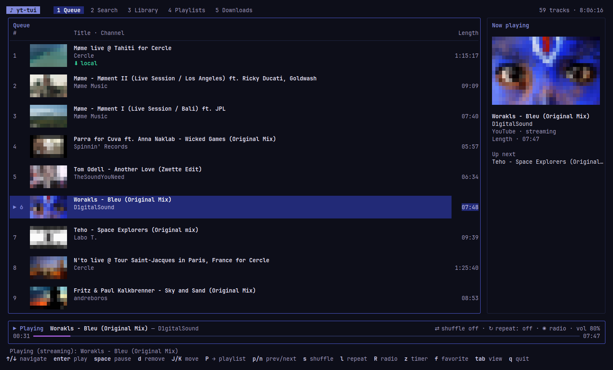

# yt-tui

[English](README.md) · **Français**

Lecteur de musique YouTube en terminal, construit avec [Charm](https://charm.sh)
(Bubble Tea, Bubbles, Lip Gloss). Recherche et téléchargement via
[yt-dlp](https://github.com/yt-dlp/yt-dlp), lecture via `mpv` (piloté par IPC).



## Interface
Thème Lip Gloss adaptatif (clair/sombre), onglets, panneau lecteur avec barre de progression en dégradé
et **miniatures** devant chaque morceau. Elles sont dessinées en demi-blocs `▀` (couleurs 24 bits : un
terminal truecolor donne le meilleur rendu), téléchargées en arrière-plan depuis `i.ytimg.com` et mises
en cache dans `~/.cache/yt-tui/thumbs`.

## Intégration au système (MPRIS)
yt-tui s'annonce sur le bus D-Bus de session comme lecteur `org.mpris.MediaPlayer2.yt-tui`. Le widget son
de Cinnamon (ou GNOME/KDE), les touches multimédia et `playerctl` affichent donc le titre, l'artiste, la
pochette et la progression, et pilotent lecture/pause, suivant/précédent, stop, volume et seek (seek
désactivé pendant un streaming). Sans bus de session, l'application fonctionne normalement sans cette
intégration. Si plusieurs instances tournent, les suivantes se nomment `…yt-tui.instance<pid>`.

## Installation rapide
```
curl -fsSL https://raw.githubusercontent.com/kevinbalicot/yt-tui/main/install.sh | bash
```
Installe le binaire (Linux amd64/arm64, somme SHA256 vérifiée) dans `~/.local/bin` et signale les
dépendances manquantes. Variables : `YT_TUI_VERSION` (ex. `0.2.0`), `YT_TUI_PREFIX` (défaut `~/.local`).
Désinstaller : `curl -fsSL …/install.sh | bash -s -- --uninstall`.

## Prérequis
`go` ≥ 1.24, `yt-dlp`, `mpv`, `ffmpeg`, et un runtime JavaScript (`deno`, `node` ou `bun`,
exigé par YouTube pour yt-dlp).

## Lancer
```
go build -o yt-tui ./cmd/yt-tui && ./yt-tui
```
Options : `--dir` (téléchargements, défaut `~/Music/yt-tui`), `--format` (mp3|opus|m4a|flac|wav),
`--auto-cache` (télécharge en arrière-plan ce qui est lu en streaming), `--results` (1–50),
`--transparent` (garde le fond du terminal au lieu de peindre celui de l'application),
`--static-theme` (palette fixe : par défaut, accents, bordures et fond suivent les couleurs
dominantes de la miniature de la piste en cours). L'application garde une marge autour de l'écran
(2 colonnes / 1 ligne, réduite sur les petits terminaux).

**Langue** : l'interface existe en français et en anglais ; elle suit la langue du système
(`LC_ALL`, `LC_MESSAGES`, `LANGUAGE`, `LANG`) — français si elle commence par `fr`, anglais sinon.
`--lang fr|en` (ou `YT_TUI_LANG=en`) la force. Les playlists « Récents » et « Favoris » sont stockées
sous leur nom français et affichées traduites.

`--no-resume` ne restaure pas la file et la position de la session précédente (sauvegardées à la
sortie dans `~/.config/yt-tui/session.json`, reprise avec `espace`), `--no-notify` coupe les
notifications de bureau au changement de piste (envoyées seulement quand la fenêtre n'a pas le focus, si le terminal le signale), `--version` affiche la version.

### Sans interface
```
yt-tui search [-n N] [--json] <requête>        # id, durée, chaîne, titre
yt-tui download [--dir D] [--format F] <url | id | requête>
yt-tui list [--dir D] [--json]                 # bibliothèque locale
```

### Installation / paquet
`make build` · `make test` · `make install` (dans `~/.local/bin`) · `make deb` (→ `dist/yt-tui_<version>_<arch>.deb`).

`--debug` écrit `yt-tui.log` et `mpv.log` dans `~/.config/yt-tui/` pour diagnostiquer un problème.

Au premier lancement, `~/.config/yt-tui/yt-dlp.conf` est créé (runtime JS, client YouTube) ;
il est utilisé par la recherche, le téléchargement et le streaming mpv. Modifiez-le si YouTube change.

## Raccourcis
Interface d'après la maquette : 5 onglets (`1` File, `2` Recherche, `3` Bibliothèque, `4` Playlists, `5` Téléchargements).

| Touche | Action |
|---|---|
| `tab` / `1`–`5` | changer d'onglet |
| `↑`/`↓`, `pgup`/`pgdn`, `g`/`G` | naviguer |
| `entrée` | lire (une playlist/chaîne dans la recherche : l'ouvrir, `esc` pour revenir) |
| `q` | quitter (confirmation : `entrée`; `ctrl+c` quitte directement) |
| `espace` | pause · `,` / `.` (ou `←`/`→`) seek ±5 s · `+`/`-` volume · `p` / `n` (ou `<` / `>`) précédent / suivant |
| `s` / `l` | aléatoire / répéter (off → file → piste) |
| `R` / `z` | radio automatique (suggestions YouTube en fin de file) / minuteur de sommeil (15 → 30 → 60 min → fin de piste) |
| `f` | favori ♥ (playlist « Favoris ») |
| `a` | ajouter à la file · `A` (playlist ouverte) tout ajouter, avec confirmation au-delà de 10 pistes · `D` télécharger · `P` → playlist (créée si absente) |
| **File** | `d` retirer · `J`/`K` déplacer |
| **Recherche** | `/` saisir · `entrée` lancer · `ctrl+f` type (tout, vidéos, playlists, chaînes) |
| **Bibliothèque** | `←`/`→` colonne (artistes → albums → pistes) · `r` réanalyser · `/` filtrer · `e` éditer artiste/album · `X` supprimer le fichier (confirmation) |
| **Playlists** | `←`/`→` liste / pistes · `N` nouvelle · `R` renommer · `X` supprimer · `d` retirer · `J`/`K` réordonner · `e` exporter en `.m3u` (dans le dossier de musique) · « Récents » : historique en lecture seule |

Bibliothèque : les téléchargements embarquent leurs métadonnées (artiste, album, année) lues par `ffprobe` ;
l'index est mis en cache dans `~/.cache/yt-tui/library.json` (seuls les fichiers nouveaux ou modifiés sont ré-analysés).

Données : playlists dans `~/.config/yt-tui/playlists.json`, fichiers nommés `Titre [id].ext`.
