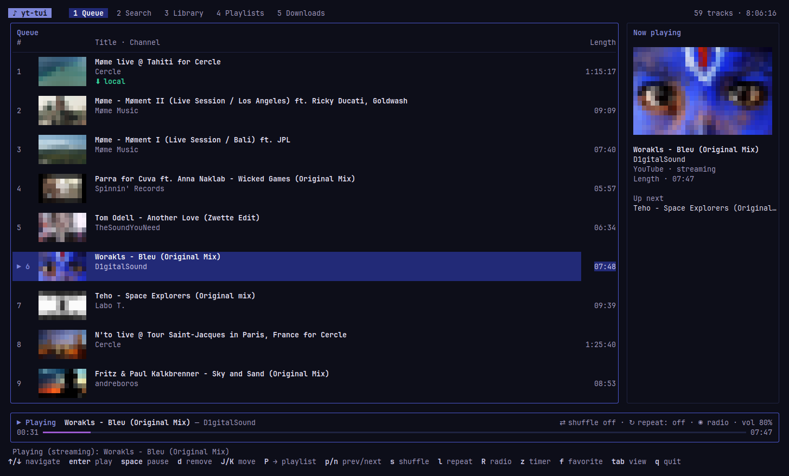

# yt-tui

A YouTube music player for the terminal, built with [Charm](https://charm.sh)
(Bubble Tea, Bubbles, Lip Gloss). Search and download through
[yt-dlp](https://github.com/yt-dlp/yt-dlp), playback through `mpv` (driven over IPC).



## Interface
Adaptive Lip Gloss theme (light/dark), tabs, and a player panel with a gradient progress bar and
**thumbnails** next to every track. They are drawn with `▀` half-blocks (24-bit colors: a truecolor
terminal gives the best result), downloaded in the background from `i.ytimg.com` and cached in
`~/.cache/yt-tui/thumbs`.

## System integration (MPRIS)
yt-tui registers on the session D-Bus as the player `org.mpris.MediaPlayer2.yt-tui`. The sound applet of
Cinnamon (or GNOME/KDE), media keys and `playerctl` therefore show the title, artist, cover art and
progress, and control play/pause, next/previous, stop, volume and seek (seek is disabled while
streaming). Without a session bus, the application works normally without this integration. When several
instances run, the following ones are named `…yt-tui.instance<pid>`.

## Quick install
```
curl -fsSL https://raw.githubusercontent.com/boutdecode/yt-tui/main/install.sh | bash
```
Installs the binary (Linux amd64/arm64, SHA256 checksum verified) in `~/.local/bin` and reports missing
dependencies. Variables: `YT_TUI_VERSION` (e.g. `0.1.0`), `YT_TUI_PREFIX` (default `~/.local`).
Uninstall: `curl -fsSL …/install.sh | bash -s -- --uninstall`.

## Requirements
`go` ≥ 1.24, `yt-dlp`, `mpv`, `ffmpeg`, and a JavaScript runtime (`deno`, `node` or `bun`,
required by YouTube for yt-dlp).

## Run
```
go build -o yt-tui ./cmd/yt-tui && ./yt-tui
```
Options: `--dir` (downloads, default `~/Music/yt-tui`), `--format` (mp3|opus|m4a|flac|wav),
`--auto-cache` (download in the background what is streamed), `--results` (1–50),
`--transparent` (keep the terminal background instead of painting the application's),
`--static-theme` (fixed palette: by default, accents, borders and background follow the dominant colors
of the current track's thumbnail). The application keeps a margin around the screen
(2 columns / 1 row, reduced on small terminals).

**Language**: the interface is available in French and English; it follows the system language
(`LC_ALL`, `LC_MESSAGES`, `LANGUAGE`, `LANG`) — French if it starts with `fr`, English otherwise.
`--lang fr|en` (or `YT_TUI_LANG=en`) forces it. The “Recent” and “Favorites” playlists are stored
under their French names (“Récents”, “Favoris”) and displayed translated.

`--no-resume` does not restore the queue and position of the previous session (saved on exit in
`~/.config/yt-tui/session.json`, resume with `space`), `--no-notify` turns off desktop notifications
on track change (sent only when the window is not focused, if the terminal reports focus),
`--version` prints the version.

### Headless
```
yt-tui search [-n N] [--json] <query>          # id, duration, channel, title
yt-tui download [--dir D] [--format F] <url | id | query>
yt-tui list [--dir D] [--json]                 # local library
```

### Install / package
`make build` · `make test` · `make install` (into `~/.local/bin`) · `make deb` (→ `dist/yt-tui_<version>_<arch>.deb`).

`--debug` writes `yt-tui.log` and `mpv.log` in `~/.config/yt-tui/` to diagnose a problem.

On first launch, `~/.config/yt-tui/yt-dlp.conf` is created (JS runtime, YouTube client); it is used by
search, download and mpv streaming. Edit it if YouTube changes.

At launch, yt-tui checks in the background (GitHub releases API, nothing about you is sent) whether a newer yt-dlp
exists and shows a status message if so; disable with `--no-update-check`.

### "Sign in to confirm you're not a bot"
YouTube sometimes asks yt-dlp to prove it is not a bot (depends on the video and your IP). Fix: let yt-dlp use the
cookies of a browser where you are logged in to YouTube, by adding this line to `~/.config/yt-tui/yt-dlp.conf`:

```
--cookies-from-browser firefox
```

Replace `firefox` with `chrome`, `chromium`, `brave`… (Chromium-based browsers may need to be closed), or use
`--cookies /path/to/cookies.txt` with an exported file. If the error comes back, log in to YouTube again in that browser.

## Shortcuts
Five tabs (`1` Queue, `2` Search, `3` Library, `4` Playlists, `5` Downloads).

| Key | Action |
|---|---|
| `tab` / `1`–`5` | switch tab |
| `↑`/`↓`, `pgup`/`pgdn`, `g`/`G` | navigate |
| `enter` | play (a playlist/channel in Search: open it, `esc` to go back) |
| `q` | quit (confirm with `enter`; `ctrl+c` quits immediately) |
| `space` | pause · `,` / `.` (or `←`/`→`) seek ±5 s · `+`/`-` volume · `p` / `n` (or `<` / `>`) previous / next |
| `s` / `l` | shuffle / repeat (off → queue → track) |
| `R` / `z` | auto radio (YouTube suggestions at the end of the queue) / sleep timer (15 → 30 → 60 min → end of track) |
| `f` | favorite ♥ (“Favorites” playlist) |
| `a` | add to queue · `A` (opened playlist) add all, with confirmation above 10 tracks · `D` download · `P` → playlist (created if missing) |
| **Queue** | `d` remove · `J`/`K` move |
| **Search** | `/` type · `enter` search · `ctrl+f` type (all, videos, playlists, channels) |
| **Library** | `←`/`→` column (artists → albums → tracks) · `r` rescan · `/` filter · `e` edit artist/album · `X` delete the file (confirmation) |
| **Playlists** | `←`/`→` list / tracks · `N` new · `R` rename · `X` delete · `d` remove · `J`/`K` reorder · `e` export as `.m3u` (in the music folder) · “Recent”: read-only history |

Library: downloads embed their metadata (artist, album, year), read with `ffprobe`; the index is cached
in `~/.cache/yt-tui/library.json` (only new or modified files are rescanned).

Data: playlists in `~/.config/yt-tui/playlists.json`, files named `Title [id].ext`.
